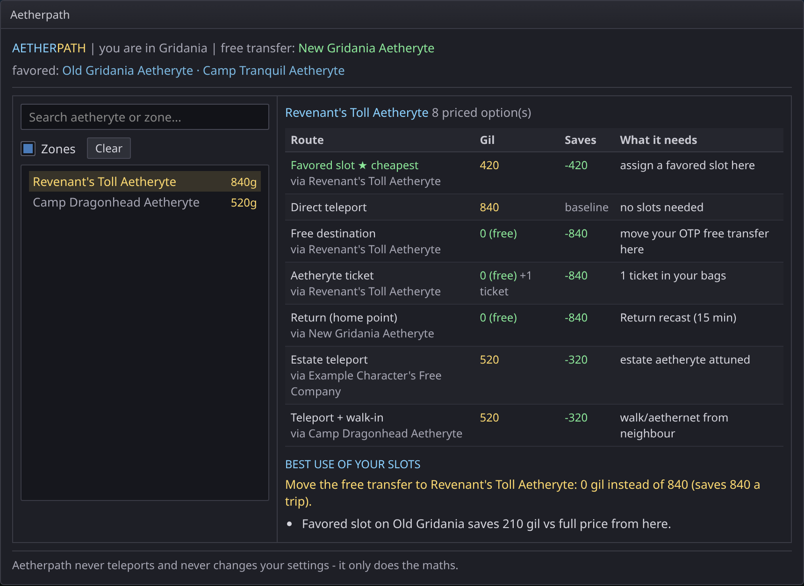
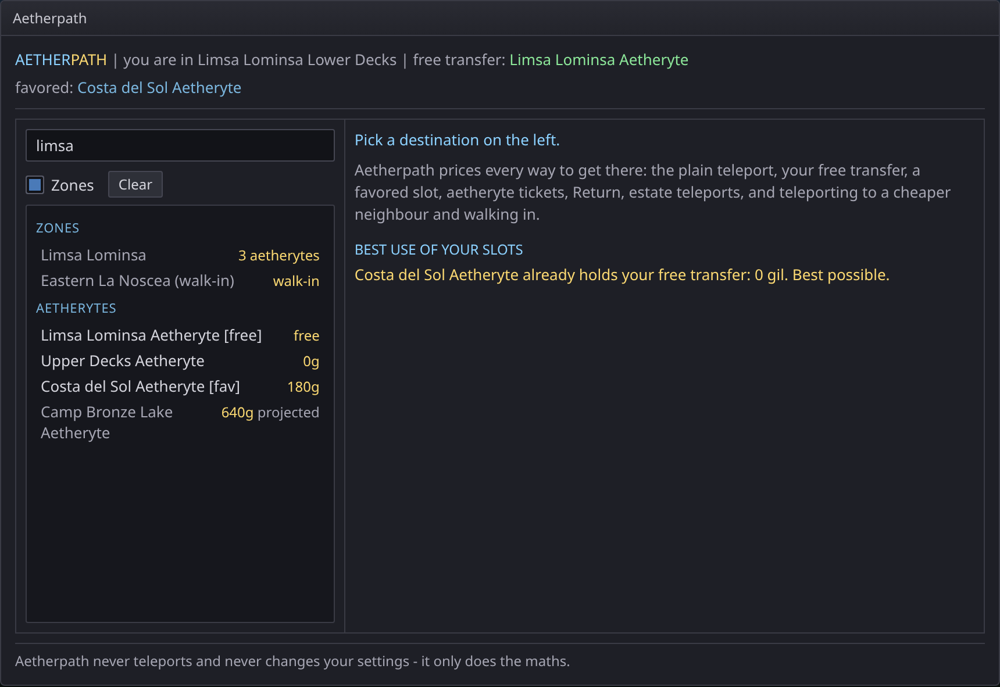
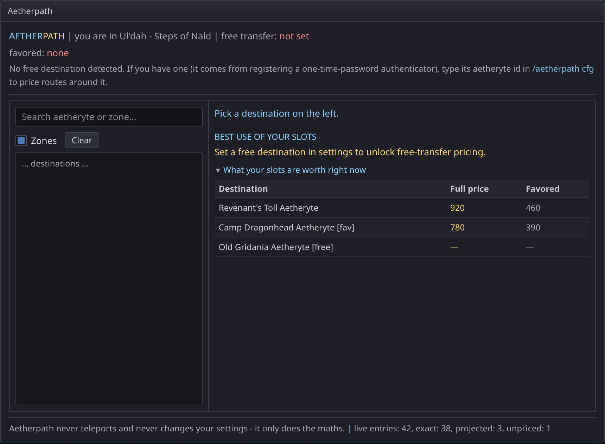
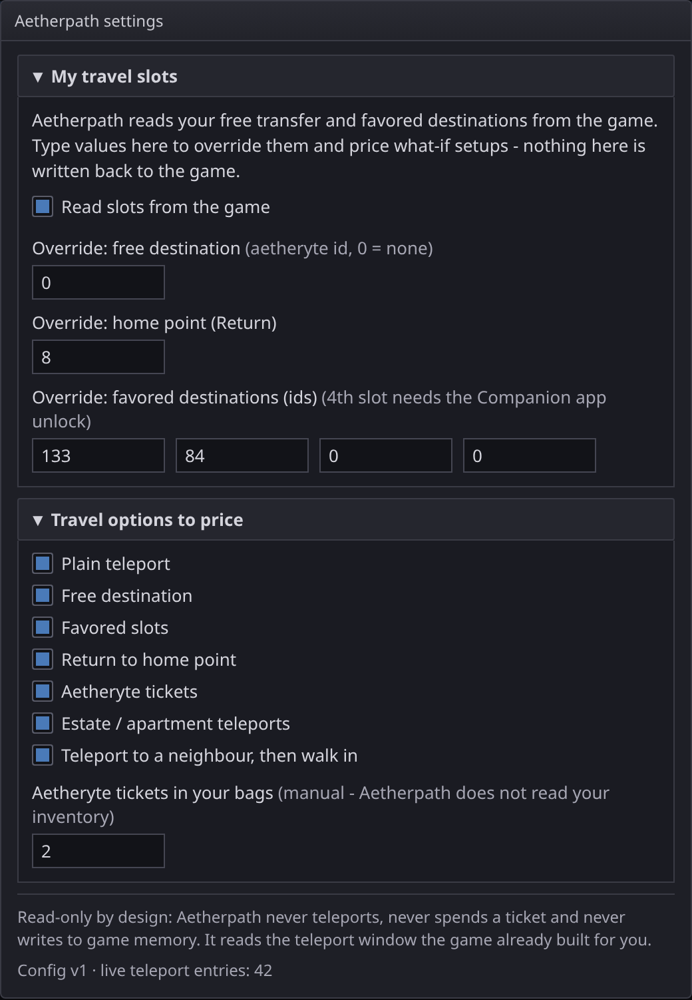
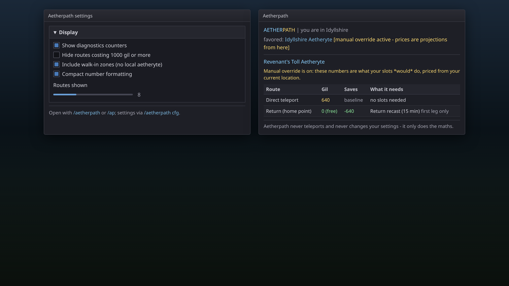
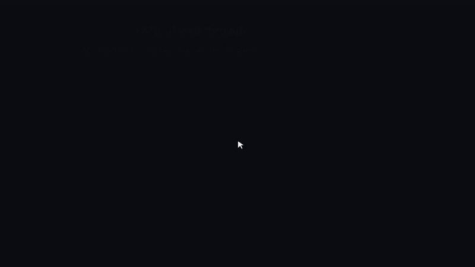

# Aetherpath


Prices every way to get where you're going in FFXIV, and shows where your free transfer and favored destinations earn the most gil.

`/aetherpath` · Dalamud API 15 · .NET 10

## What it does

- **Read-only** — no teleports, no ticket spending, no changes to your free/favored settings, no writes to game memory. It reads the teleport window the game already built and does the maths.
- **Ranks every route** — direct teleport, OTP free transfer, favored slot, aetheryte ticket, Return to your home point, estate or apartment teleport, or a cheaper neighbour plus a walk / aethernet leg.
- **Values your slots** — the slot optimizer prices what moving the free transfer or a favored slot would save, what the destination holding it now would go back to costing, and which destinations each perk is worth most on.
- **Prices what-ifs** — overrides answer "what if my free transfer were Revenant's Toll?"; whenever one is in force the window says so, because the numbers become projections from where you stand.

## How it works

Home, free and favored ids prefer `IPlayerState` (`HomeAetheryte`, `FreeAetheryte`, `FavoriteAetherytes`); live prices and favored flags come from `IAetheryteList`, with a SubIndex-matched `Telepo.TeleportList[].IsFreeAetheryte` fallback. Favored slots are three, or four with the Companion app unlock; auto-read takes what the game reports. An override matching the game's own setup collapses back to its exact prices.

| Number | Source | Accuracy |
| --- | --- | --- |
| What you'd pay now | Game teleport list, perks applied | Exact |
| Full price, un-discounted destination | Same number | Exact |
| Full price, currently favored | Live × 2 (favored bills 50%; the fee cap applies before discounts) | ±1 gil, projected |
| Full price, currently free | Not recoverable — the game reports 0 | Unpriced, never invented |
| Favored price, not favored | Full ÷ 2 | ±1 gil, projected |

- The ">1000 gil growth is halved" step is in the base distance curve, not the discount, so it is already inside the live numbers.
- FC actions and squadron manuals move the live price; a base derived from a live number inherits whatever was active when read.
- Return is free but on a 15 minute recast, so it is a full route only to your home point or something in the same zone — elsewhere it is the first leg only, and Aetherpath says so instead of pricing the rest.
- Tickets are counted by hand: type how many you carry and ticket routes price at 0 gil + 1 ticket.

## Commands

| Command | Effect |
| --- | --- |
| `/aetherpath` | Destination picker and route table. |
| `/aetherpath cfg` | Settings (`config` and `settings` also accepted). |
| `/ap` | Alias for `/aetherpath`; arguments work the same. |

## Screenshots

Screenshots are mock-ups illustrating the UI, not captures from the live game.

| | |
| --- | --- |
|  | **Route comparison** — ranked routes (direct, free, favored, ticket, Return, estate, walk-in) with gil, savings, and **BEST USE OF YOUR SLOTS**. Open with `/aetherpath` or `/ap`. |
|  | **Destination picker** — search, **Zones** toggle, **Clear**, zone walk-ins, aetheryte costs, and empty-state help text. |
|  | **Diagnostics & slot value** — `/aetherpath cfg` hint when free transfer is missing, **Show diagnostics counters**, and **What your slots are worth right now** table. |
|  | **Settings — slots & travel options** — `/aetherpath cfg`: auto-read, manual overrides, which travel modes to price, ticket count. |
|  | **Display options & override banner** — display toggles, **Routes shown** slider (default 8), manual-override projection warning, partial **first leg only** routes. |

Regenerate PNGs from the HTML sources: `cd docs/screenshots && npm install && npx playwright install chromium && node render.mjs`.

### Mock-up video

These are the same HTML mock-ups animated for a quick tour — **not** captures from the live game.



[Full walkthrough (MP4)](docs/videos/mockup-walkthrough.mp4)

Regenerate: `cd docs/videos && npm install && npx playwright install chromium && npm run render` (requires `ffmpeg`).

### Feature coverage

| Feature | Screenshot |
| --- | --- |
| Slash command `/aetherpath` (main window) | 01, 02, 05 |
| Slash command `/ap` (alias) | 05 |
| Slash command `/aetherpath cfg` / `config` / `settings` | 03, 04, 05 |
| Dalamud **Open Main UI** / **Open Config UI** (same windows) | 01–05 |
| Header: current zone, free transfer, favored list | 01, 02, 03, 05 |
| No live teleport data message (logged out / unattuned) | *(not pictured — replaces main table when `HasLiveData` is false)* |
| No free destination hint | 03 |
| Manual override active banner | 05 |
| Destination search | 02 |
| **Zones** checkbox & zone list (incl. walk-in) | 02 |
| **Clear** selection | 02 |
| Aetheryte list with live/projected cost tags | 02 |
| Route table: Route, Gil, Saves, What it needs | 01, 05 |
| Cheapest route marker (★ cheapest) | 01 |
| Travel modes: direct, free, favored, ticket, Return, estate, walk-in | 01 |
| Partial route (**first leg only**) | 05 |
| **BEST USE OF YOUR SLOTS** advice | 01, 02, 03 |
| **What your slots are worth right now** (diagnostics tree) | 03 |
| Footer read-only disclaimer | 01–05 |
| Diagnostics counters (live / exact / projected / unpriced) | 03 |
| Settings: **Read slots from the game** | 04 |
| Settings: override free / home / favored ids | 04 |
| Settings: travel option checkboxes (7 modes) | 04 |
| Settings: **Aetheryte tickets in your bags** | 04 |
| Settings: **Show diagnostics counters** | 05 |
| Settings: **Hide routes costing 1000 gil or more** | 05 |
| Settings: **Include walk-in zones (no local aetheryte)** | 05 |
| Settings: **Compact number formatting** (default on) | 05 |
| Settings: **Routes shown** slider (3–20, default 8) | 05 |

## Settings

- **My travel slots** — auto-read, or override the free destination, home point and four favored slots by aetheryte id, index-preserving (0 = none); nothing is written back.
- **Travel options to price** — each of the seven route types can be switched off; ticket count is manual because bags are not read.
- **Display** — diagnostics counters, compact numbers, hide routes of 1000 gil or more, include walk-in zones, 3–20 routes.

## Build

Requires the .NET 10 SDK and the Dalamud dev distribution (`%APPDATA%\XIVLauncher\addon\Hooks\dev`, or `DALAMUD_HOME`).

```
dotnet build -c Debug      # bin/Debug/Aetherpath.dll + generated Aetherpath.json manifest
dotnet build -c Release    # zip in bin/Release/Aetherpath/latest.zip
```

The manifest comes from the MSBuild properties in `Aetherpath.csproj` — never hand-edit it.

## Install (dev plugin)

1. `/xlsettings` → Experimental → Dev Plugin Locations → add the full path to `bin\Debug\Aetherpath.dll`.
2. `/xlplugins` → Dev Tools → enable **Aetherpath**.
3. `/aetherpath` opens the window; `/aetherpath cfg` opens settings.
4. Hot-reload works: rebuild and the game picks up the new DLL.

## Tests

Two offline harnesses; neither needs the game. `tools/mathcheck` covers the discount maths in `Core/CostModel.cs` (round-trip stability, ±1 gil favored rounding, unpriced free destinations); `tools/logiccheck` covers slot override merge, projected favored exactness and zone-name walk-in selection (`Core/SlotLogic.cs`). Last run of mathcheck: `ALL CHECKS PASSED`, worst rounding delta 1 gil.

```
cd tools/mathcheck && dotnet run -c Release
cd tools/logiccheck && dotnet run -c Release
```

## Limits

- **Not verified in game.** Never run inside FFXIV from this repository: the maths and sheet assumptions are checked offline, the live `Telepo.TeleportList` read and the window layout need a session. If a price looks wrong, compare it with the Teleport window and read the diagnostics counters for exact vs projected entries.
- Walk-in zone grouping was checked against the game's sheets, not in game: Ul'dah's two territories both report `PlaceNameZone = "Ul'dah"`, Limsa Lominsa Lower Decks reports `"Limsa Lominsa"` (its region is the broader `"La Noscea"`), so same-zone neighbours are the ones you can walk or aethernet between.
- Nothing is priced without a logged-in character: the numbers come from the game's teleport list, so the route table stays empty at the title screen.

## Layout

```
Aetherpath.csproj          MSBuild manifest properties + SDK reference
Plugin.cs                  entry point, services, /aetherpath command
Configuration.cs           preferences and the manual slot overrides
Core/Models.cs             sheet-level aetheryte and zone records
Core/GameData.cs           sheet index: names, zones, regions, walk neighbours
Core/CostModel.cs          live prices, discount inversion, free-destination flag
Core/SlotLogic.cs          pure slot-merge / pricing helpers (no Dalamud)
Core/SlotState.cs          free/favored/home slot state, live or overridden
Core/RoutePlanner.cs       ranks every travel option; slot optimizer
Windows/MainWindow.cs      destination picker, route table, slot advice
Windows/ConfigWindow.cs    settings
tools/mathcheck/           standalone harness for the discount maths
tools/logiccheck/          standalone harness for slot merge + walk-in logic
```
